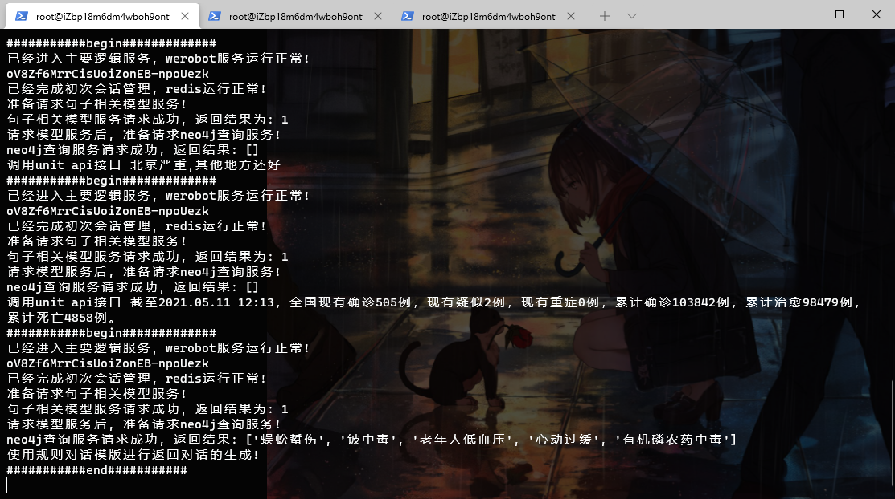
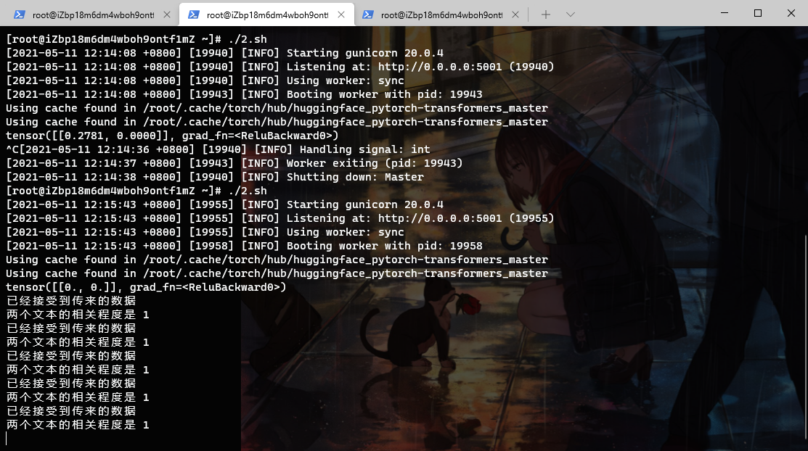
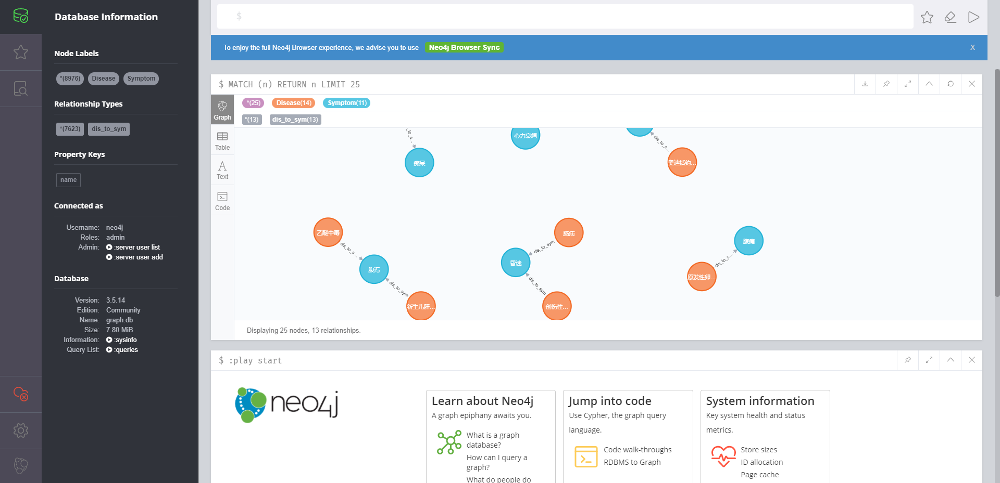
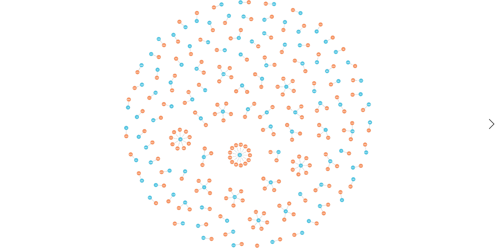

# Deep Learning NLP Graduation Project
Author: yrq

## Overall Project Architecture
(Follow the WeChat Official Account "North China University of Technology AI Assistant" - already live and deployed)

Framework: PyTorch + Flask + Baidu Unit API

Offline Part: Data Crawler (PySpider) + Data Cleaning (NER (Named Entity Recognition model) and NE (Named Entity Review model)) + Neo4j (NoSQL Graph Database)

Online Part: werobot (Interface for WeChat server) + Redis (Online cache NoSQL database) + bert-chinese (Model optimization and fine-tuning)

Deployment: Linux (Alibaba Cloud CentOS / Tencent Cloud CentOS), Gunicorn paired with Flask to control single processes, and Supervisor service monitor to ensure smooth operation of the entire project process.

> The project is divided into two main modules:

Online Module:
`on_line`

Offline Module: Responsible for RNN model training and BiLSTM-CRF model training:
`off_line`

***

If you need to use this project:

`off_line` is only provided to help understand the data cleaning process.

You only need to set up the Neo4j graph database, the files under `on_line`, and the `reviewed` files under `rnn_model`.
***

## Installing Neo4j

Installation process for the Neo4j graph database:

* Step 1: Load Neo4j installation information into the yum repository list.
```vim
cd /tmp
wget http://debian.neo4j.org/neotechnology.gpg.key
rpm --import neotechnology.gpg.key
cat <<EOF>  /etc/yum.repos.d/neo4j.repo
# Write the following content
[neo4j]
name=Neo4j RPM Repository
baseurl=http://yum.neo4j.org/stable
enabled=1
gpgcheck=1
EOF
```
* Step 2: Install using the `yum install` command.
```shell script
yum install neo4j-3.3.5
```
* Step 3: Modify the configuration file `/etc/neo4j/neo4j.conf`.
```shell script
# Database storage location, log location, etc.
dbms.directories.data=/var/lib/neo4j/data
dbms.directories.plugins=/var/lib/neo4j/plugins
dbms.directories.certificates=/var/lib/neo4j/certificates
dbms.directories.logs=/var/log/neo4j
dbms.directories.lib=/usr/share/neo4j/lib
dbms.directories.run=/var/run/neo4j

# Import location
dbms.directories.import=/var/lib/neo4j/import

# Initial memory size
dbms.memory.heap.initial_size=512m

# Bolt connection address
dbms.connector.bolt.enabled=true
dbms.connector.bolt.tls_level=OPTIONAL
dbms.connector.bolt.listen_address=0.0.0.0:7687
```
* Step 4: Start the Neo4j database.
> Start the database:
```shell script
neo4j start 
```
Upload the `reviewed` folder from `rnn_model/structured/reviewed` to the server.
> Write the folder contents into the Neo4j graph database:
```shell script
python write_neo4j.py
```
> Database testing:
```shell script
python test_neo4j.py
```

## on_line Part

Redis installation:
```shell script
yum install redis -y
pip install redis
```
Redis startup:
```shell script
redis-server
```
Redis testing (Note: adjust the path to match your own directory):
```shell script
python test_redis.py
```

Gunicorn:
Since there were issues using Gunicorn with Python 3, `run_gunicorn.py` was written to resolve this.
```shell script
pip install gunicorn==20.0.4
```

Flask installation:
```shell script
pip install Flask==1.1.1
```

Upload the entire `on_line` folder to the server for deployment. Run the following commands in sequence (requires separate windows/terminals; note your own directories):
```shell script
nohup python  ~/ai_doctor/on_line/wr.py   & 
python ~/ai_doctor/on_line/main_server/run_gunicorn.py -w 1 -b 0.0.0.0:5000 app:app 
python ~/ai_doctor/on_line/bert_server/run_gunicorn.py -w 1 -b 0.0.0.0:5001 app:app 
```
> Please note:

The server must have 4GB of RAM or more; 2GB is insufficient.

My solution was to set up two servers with 2GB of RAM and communicate via HTTP:

One server deploys the Neo4j database.

One server deploys all contents of the `on_line` files.

> Screenshots:








## Extensions
`setting_speed.py` uses the Tsinghua mirror to accelerate downloads.

The author developed the project on Windows 10 using PyCharm. Models were fully trained before being uploaded to the server for deployment.

## Problem Log
### 1. GitHub Arrow Folders

This occurs because the folder contains hidden `.git` files, causing GitHub to treat it as a submodule.

The solution is:

1. Delete the `.git` folder inside that directory.

2. Execute `git rm --cached [folder_name]`

3. Execute `git add [folder_name]`

4. Execute `git commit -m "msg"`

5. Execute `git push origin [branch_name]`
